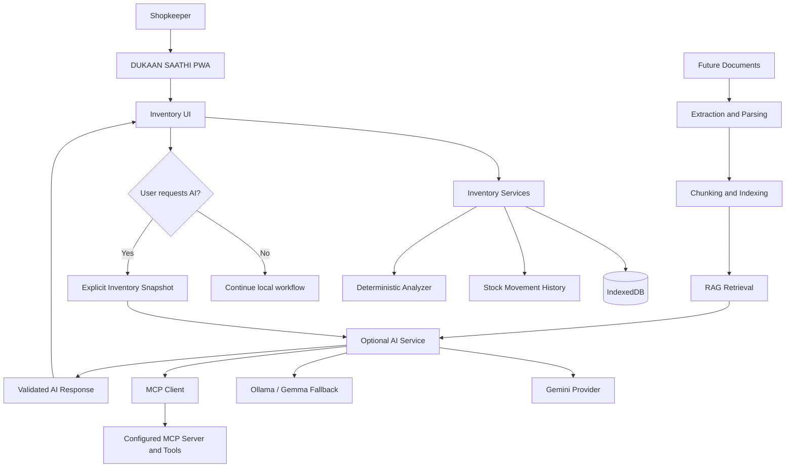
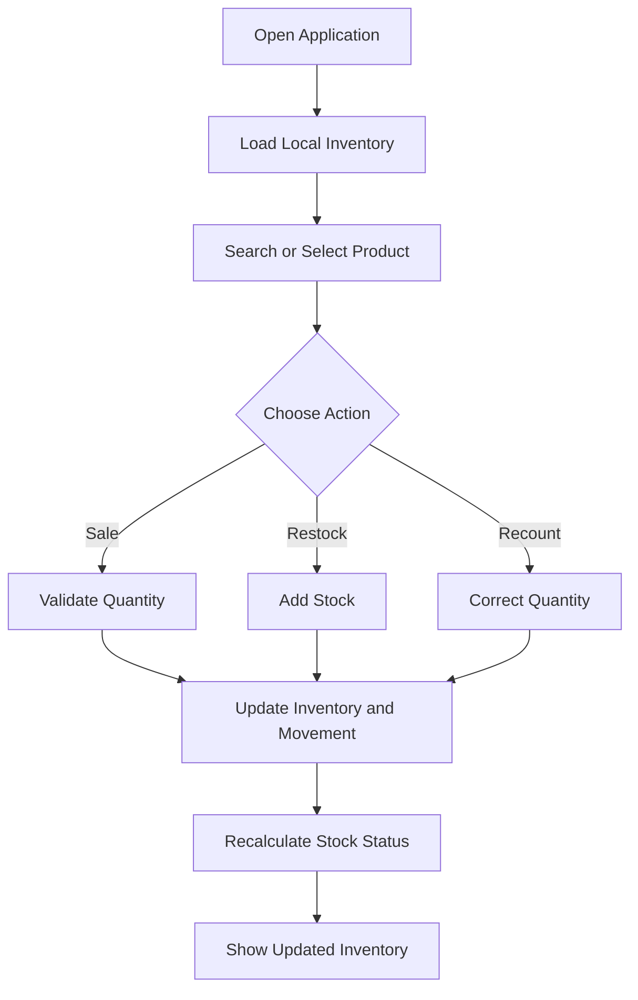
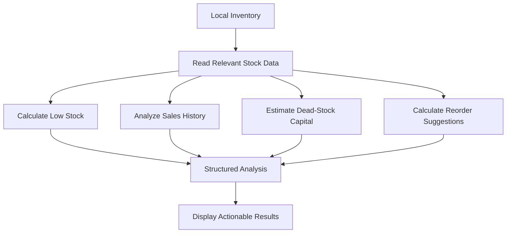
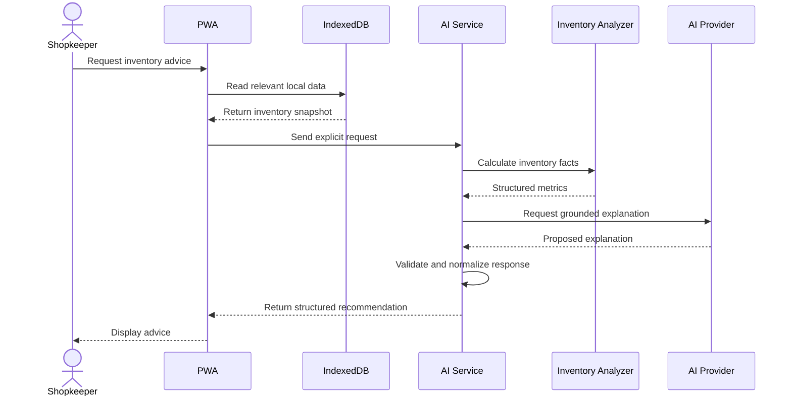
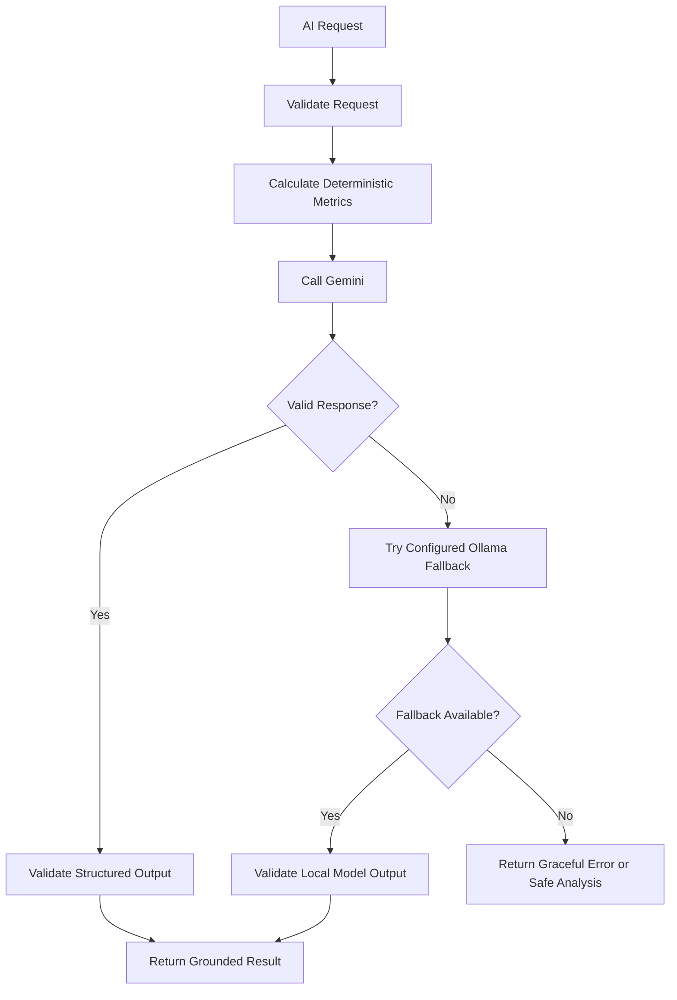
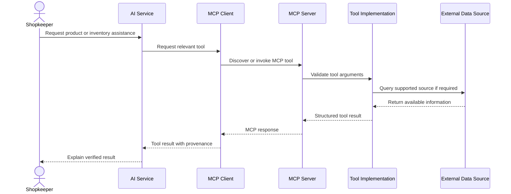
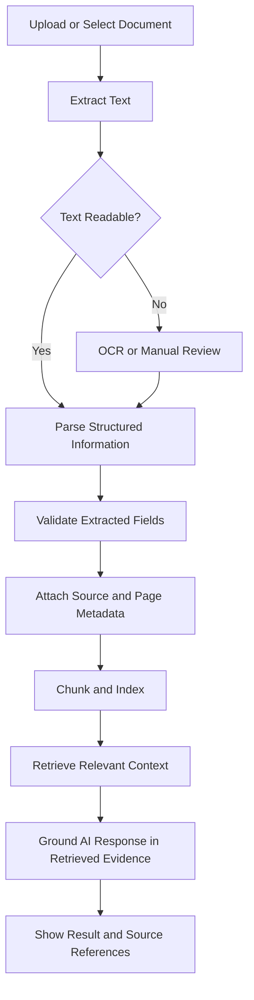

# DUKAAN SAATHI (दुकान साथी)

### Your Trusted Partner for Smarter Shop Management

**DUKAAN SAATHI** is an offline-first inventory and reorder assistant designed for local kirana stores and neighbourhood retailers. It helps shopkeepers manage stock, record sales, identify low-stock products, track slow-moving inventory, estimate tied-up capital, and prepare reorder lists through a simple, mobile-friendly interface.

Our mission is to make everyday shop management easier, more accessible, and more reliable—even when the internet is unavailable.

> **Core principle:** Essential shop operations must work offline. AI is an optional assistant, never a requirement for managing inventory.

---

## Table of Contents

- [Project Overview](#-project-overview)
- [Problem Statement](#-problem-statement)
- [Our Solution](#-our-solution)
- [Key Features](#-key-features)
- [Product Scope](#-product-scope)
- [Technology Stack](#-technology-stack)
- [System Architecture](#-system-architecture)
- [How the Application Works](#-how-the-application-works)
- [AI Architecture](#-ai-architecture)
- [MCP Integration](#-mcp-integration)
- [Future: Document Extraction and RAG](#-future-document-extraction-and-rag)
- [Product, Pricing and GST Data](#-product-pricing-and-gst-data)
- [Project Structure](#-project-structure)
- [Getting Started](#-getting-started)
- [Environment Configuration](#-environment-configuration)
- [Testing and Validation](#-testing-and-validation)
- [Demo Workflow](#-demo-workflow)
- [Offline-First Design](#-offline-first-design)
- [Security and Reliability](#-security-and-reliability)
- [Development Roadmap](#-development-roadmap)
- [Project Principles](#-project-principles)
- [Contributing](#-contributing)
- [License](#-license)

---

## 📌 Project Overview

Small retailers frequently manage their inventory using notebooks, memory, calculators, or basic spreadsheets. These methods can make it difficult to track stock accurately, identify products that need reordering, and understand how much money is tied up in unsold inventory.

DUKAAN SAATHI aims to provide a lightweight digital alternative without forcing shopkeepers to depend on a permanent internet connection, a complicated dashboard, or an AI subscription.

The application follows an **offline-first, local-data-first architecture**. Inventory data is stored in the browser using IndexedDB, while a Progressive Web App (PWA) makes the application installable and helps it remain accessible when offline.

An optional AI service adds a layer of inventory analysis and recommendations. Future modules will introduce external tools through MCP and document-based knowledge retrieval through RAG.

### Our Vision

To build a practical digital companion for small retailers that combines reliable offline inventory management with explainable, AI-assisted business decisions.

---

## 🎯 Problem Statement

Neighbourhood retailers face several everyday challenges:

- Tracking stock manually takes time and can lead to mistakes.
- Low-stock products may go unnoticed until customers request them.
- Overstocked and slow-moving products can lock up working capital.
- Preparing supplier reorder lists manually is inconvenient.
- Internet connectivity may be unreliable or expensive.
- Complicated inventory systems can be difficult to adopt.
- Product prices, pack sizes, and tax information may be scattered across different sources.

Most importantly, small retailers need tools that solve their immediate problems before introducing advanced technology.

DUKAAN SAATHI addresses these challenges progressively, starting with dependable stock management and then introducing optional AI-powered assistance.

---

## 💡 Our Solution

DUKAAN SAATHI combines four layers:

| Layer | Responsibility |
|---|---|
| Offline-first PWA | Everyday inventory operations without internet |
| Local inventory intelligence | Stock calculations, alerts, and reorder suggestions |
| Optional AI service | Natural-language explanations and inventory recommendations |
| Future MCP and RAG layer | Tool-assisted lookups and document-based knowledge retrieval |

The layers are designed to remain separate. If the AI provider, external API, or MCP server is unavailable, the core inventory application must continue to work.

---

## ✨ Key Features

### 📦 Inventory Management

- Add products with names, quantities, and units.
- Support fractional quantities where appropriate.
- Configure minimum stock thresholds.
- Record optional purchase costs.
- Restock existing products.
- Correct stock through a recount workflow.
- Search and filter the inventory.
- Persist inventory data locally using IndexedDB.

Supported units include:

`pkt`, `kg`, `g`, `L`, `ml`, `pc`, and `box`.

Starter product suggestions include Tata Salt, Fortune Oil, Sugar, Atta, Maggi, Parle-G, Dettol Soap, and Toor Dal.

### 🛒 Rapid Sales

- Record a sale using a quick action.
- Use a default sale quantity of one unit.
- Prevent accidental duplicate sales caused by repeated taps.
- Update inventory and record the corresponding stock movement.
- Undo the last sale when supported by the current application state.
- Preserve the movement history when a sale is undone.

Undoing a sale should restore the relevant quantity while marking the original movement as undone, rather than silently deleting the audit record.

### ⚠️ Low-Stock Alerts

Identify products whose current quantity has reached or fallen below their configured minimum stock level.

The core rule is:

`quantity <= minimumStock`

These alerts help shopkeepers identify products that may need replenishment.

### 💤 Slow-Moving and Dead Stock

Identify products that have not sold within a configurable period.

The default analysis period is 30 days, with a shorter demo period available for testing.

The analysis should distinguish between:

- **Never sold:** No recorded sale exists.
- **Not moving:** A previously sold product has not sold within the configured period.
- **Newly added:** A product has not existed long enough to be evaluated fairly.

This distinction prevents newly added products from automatically being classified as dead stock.

### 💰 Tied-Up Capital

Estimate the purchase-cost value of inventory that has been classified as dead stock.

`Tied-up capital = Σ(quantity × costPrice)`

This is an estimate based on recorded purchase costs, not a valuation of guaranteed recoverable money or profit.

Products without a valid purchase cost should not receive invented cost values.

### 🔄 Reorder Assistance

Calculate a basic reorder suggestion from the configured minimum stock level and current quantity.

`suggestedQuantity = max(0, 2 × minimumStock − currentQuantity)`

This formula provides a simple replenishment target. It does not automatically account for supplier lead times, seasonal demand, or sales forecasts.

### 📲 Reorder List Sharing

- Prepare a list of products that need replenishment.
- Share the list using the Web Share API where supported.
- Provide a WhatsApp-compatible sharing option.
- Keep sharing optional and initiated by the shopkeeper.

### 💾 Backup and Restore

- Export inventory data as JSON.
- Restore a previously exported backup.
- Validate imported data before changing the current inventory.
- Preserve data integrity and warn about potentially destructive restore operations.

### 🌐 Progressive Web App

- Installable application experience.
- Service Worker caching for the application shell.
- Web App Manifest.
- Responsive, mobile-first interface.
- Offline access after the required application assets have been cached.

### 🇮🇳 Built for Local Retailers

- Simple Hindi and English labels.
- Mobile-friendly controls.
- Familiar product units.
- Hinglish-friendly search as the project evolves.
- Clear stock status and actionable recommendations.

---

## 🧩 Product Scope

### P0 — Essential Inventory Features

The first priority is to make everyday stock management reliable.

- [ ] Add and manage products.
- [ ] Store inventory in IndexedDB.
- [ ] Record sales and restocks consistently.
- [ ] Prevent duplicate sale actions.
- [ ] Undo a sale while preserving its movement record.
- [ ] Support fractional quantities.
- [ ] Correct stock through recounting.
- [ ] Identify low-stock products.
- [ ] Identify products that are not moving.
- [ ] Support offline operation.
- [ ] Provide clear Hindi and English labels.
- [ ] Validate the core application with repeatable tests.

### P1 — Productivity and Intelligence

- [ ] Calculate tied-up capital for dead stock.
- [ ] Suggest reorder quantities.
- [ ] Share reorder lists.
- [ ] Export and restore JSON backups.
- [ ] Load realistic demo inventory and sales history.
- [ ] Improve Hinglish search and transliteration.
- [ ] Add lightweight audio feedback.
- [ ] Support keyboard shortcuts.
- [ ] Introduce optional AI-generated inventory explanations.
- [ ] Validate AI outputs against deterministic inventory data.

### P2 — Advanced Assistance

- [ ] Complete and verify a genuine MCP server integration.
- [ ] Add product catalogue and barcode lookup integrations.
- [ ] Add verified product pricing and GST information sources.
- [ ] Extract structured information from invoices and other documents.
- [ ] Build a document-grounded RAG pipeline.
- [ ] Add supplier and purchasing workflow assistance.
- [ ] Explore demand forecasting when sufficient reliable history exists.

The roadmap is intentional: reliable inventory operations come first, followed by AI, external tools, and document intelligence.

---

## 🛠 Technology Stack

### Frontend and Offline Application

| Technology | Purpose |
|---|---|
| HTML5 | Application structure |
| Vanilla CSS | Responsive interface and styling |
| JavaScript ES Modules | Application logic and modular services |
| IndexedDB | Persistent local inventory storage |
| Service Worker | Application-shell caching and offline support |
| Web App Manifest | Installable PWA configuration |
| Web Share API | Optional sharing functionality |
| Web Audio API | Optional sound feedback |

The existing application uses vanilla JavaScript. The project does not require a migration to React to support the AI architecture.

### Optional AI Service

| Technology | Purpose |
|---|---|
| Node.js | AI service runtime |
| Express.js | HTTP API and routing |
| Gemini API | Primary AI provider |
| Ollama | Local inference runtime and fallback |
| Gemma | Locally runnable model, subject to available installation |
| Official MCP SDK | Model Context Protocol client/server integration |
| Automated tests | Validation of services, tools, and business rules |

### Future Document Intelligence

Potential components include:

- PDF and image document extraction.
- OCR where necessary.
- Structured document parsing.
- Text chunking and metadata management.
- Embeddings and retrieval.
- A vector index or another suitable retrieval store.
- Retrieval-Augmented Generation (RAG).

These components are planned extensions and should not be considered complete until implemented and tested.

---

## 🏗 System Architecture

DUKAAN SAATHI separates the essential offline application from the optional AI infrastructure.



### Architectural Rules

1. IndexedDB remains the source of truth for locally managed inventory.
2. Essential sales, restocks, corrections, and stock alerts must not depend on AI.
3. The browser sends inventory information to the AI service only when the user explicitly requests an AI-assisted operation.
4. The AI service should receive only the information necessary for that operation.
5. Deterministic calculations establish inventory facts; the language model explains them.
6. MCP tools must be discovered and invoked through a real MCP integration.
7. Document extraction and RAG will be introduced as separate modules.
8. External service failures must not prevent the offline application from opening or managing stock.

---

## 🔄 How the Application Works

### 1. Everyday Inventory Workflow



**Example:** A shopkeeper records a sale of one packet of Maggi. The application updates the local quantity and records the movement. If the quantity reaches the configured minimum level, the product appears in the low-stock view.

No AI call is required.

### 2. Inventory Analysis Workflow



The analyzer performs the calculations using the available inventory and movement history. An optional AI layer can explain these results in accessible language.

### 3. Optional AI Workflow



If the AI service is unavailable, the shopkeeper can continue using the local inventory features.

---

## 🤖 AI Architecture

The AI service is a separate, optional layer intended to make inventory information easier to understand and act upon.

### Provider Strategy

**Primary provider:** Gemini

**Fallback provider:** Ollama with a locally available Gemma model.

The configured model name must match the model actually installed in the Ollama environment. Model availability and Gemini API compatibility must be verified during setup.

### Responsibilities of the AI Service

The service is intended to:

- Summarize inventory conditions.
- Explain why products have been flagged as low-stock or slow-moving.
- Suggest practical investigation steps.
- Explain deterministic reorder calculations.
- Return structured recommendations.
- Handle provider errors and timeouts gracefully.
- Use a fallback provider when the configured fallback is available and appropriate.

### Deterministic Analysis Before Generation

The language model should not be responsible for calculating authoritative inventory values.

For example, if the inventory contains:

- Current quantity: 4 packets.
- Minimum stock: 10 packets.

The deterministic analyzer can calculate the basic reorder suggestion:

`2 × 10 − 4 = 16 packets`

The AI can explain why 16 packets are suggested, but it must not replace the calculated value with an unsupported quantity.

### Grounding and Validation

The service should:

- Use only the inventory information provided for the request.
- Keep evidence separate from assumptions.
- Reject or flag invalid structured output.
- Avoid inventing stock quantities, sales history, suppliers, prices, or GST rates.
- Identify missing information explicitly.
- Return a clear error or a deterministic result when generation fails.

### AI Provider Workflow



Provider fallback must be implemented and tested explicitly. A configured fallback is not proof that failover works.

---

## 🔌 MCP Integration

The Model Context Protocol (MCP) is intended to let the AI service interact with clearly defined external tools through a standard protocol.

DUKAAN SAATHI will use the official `@modelcontextprotocol/sdk` for genuine MCP client/server communication rather than relying on a custom tool registry alone.

### Planned MCP Tools

| Tool | Purpose |
|---|---|
| `analyze_inventory` | Analyze a supplied inventory snapshot |
| `get_stock_summary` | Summarize relevant stock metrics |
| `identify_low_stock` | Find products at or below minimum stock |
| `search_products` | Search a supported product catalogue |
| `lookup_product_barcode` | Look up product information by barcode |
| `lookup_gst_rate` | Retrieve supported HSN/GST information |
| `get_product_pricing_info` | Retrieve available pricing information with source metadata |

The exact tools, schemas, and external connections should be finalized based on the actual provider documentation and supported data sources.

### MCP Workflow



### MCP Requirements

- Use the official MCP SDK.
- Validate tool arguments and outputs.
- Match the MCP client's transport to the configured server transport.
- Configure the server endpoint explicitly.
- Apply request timeouts and sensible error handling.
- Keep local development servers bound to loopback interfaces where appropriate.
- Preserve source metadata for external results.
- Do not assume an MCP server is operational just because a client or tool definition exists.
- Keep MCP disabled until the server, transport, and required connections have been verified.

MCP integration is an optional extension. Ordinary stock management must not depend on an external MCP server.

---

## 📚 Future: Document Extraction and RAG

After the offline-first application, AI service, and MCP workflow are stable, the next major extension will be document intelligence.

Potential documents include:

- Supplier invoices.
- Purchase bills.
- Product catalogues.
- Price lists.
- GST or HSN reference documents.
- Supplier terms and purchasing information.

### Planned Document Processing Pipeline



### Why RAG?

Retrieval-Augmented Generation allows the system to retrieve relevant passages from a document collection before asking a language model to answer a question.

For example, a shopkeeper might ask:

> What was the last purchase price of this product according to my supplier invoices?

A future RAG workflow could retrieve the relevant invoice entries and present the extracted price with the document name, date, and supporting context.

### Data Integrity Rules

- Extracted information must be validated before it affects inventory.
- Document-derived prices must retain their source and date.
- Ambiguous fields must be flagged for review.
- Retrieved text must be treated as untrusted document content, not as system instructions.
- RAG answers should include source references where possible.
- Document ingestion must not silently overwrite current inventory.
- Any stock or financial change must require an explicit, validated action.

Document extraction and RAG are roadmap items until the complete pipeline has been implemented and tested.

---

## 🧾 Product, Pricing and GST Data

DUKAAN SAATHI may integrate external product catalogues and tax-information sources to improve product lookup and purchasing assistance.

Potential sources to evaluate include:

- **OpenMRP:** https://github.com/openmrp-in/openmrp
- **OpenMRP Developer Portal:** https://openmrp.in/developers
- **HSN/GST API documentation:** https://hsn.krakelabsindia.com/developers
- **CBIC GST goods and services rates:** https://cbic-gst.gov.in/hindi/gst-goods-services-rates.html

These are candidate references, not a guarantee that a particular API endpoint is available, free, current, or suitable for production. Verify documentation, access requirements, licensing, rate limits, response schemas, and current tax information before integration.

### Keep Financial Fields Separate

The application must not treat the following values as interchangeable:

- **MRP:** Maximum retail price.
- **Purchase price:** Cost paid to acquire stock.
- **Selling price:** Price charged by the shop.
- **HSN code:** Product classification information.
- **GST rate:** Tax rate supported by an appropriate source.

If reliable pricing or tax information cannot be found, the result should be marked as unknown or requiring review rather than guessed.

Any external result should preserve useful provenance, such as the source, retrieval time, and applicable product or classification details.

---

## 📁 Project Structure

The following is the intended high-level organization. Actual file paths may differ from this proposal and should be reconciled with the current repository before files are moved or renamed.

```text
DUKAAN-SAATHI/
│
├── index.html
├── manifest.json
├── service-worker.js
├── tests.html
│
├── assets/
│   ├── icons/
│   └── images/
│
├── src/
│   ├── app.js
│   ├── styles/
│   │   └── main.css
│   │
│   ├── db/
│   │   └── indexeddb.js
│   │
│   ├── services/
│   │   ├── inventory.service.js
│   │   ├── sales.service.js
│   │   ├── restock.service.js
│   │   └── stock-analysis.service.js
│   │
│   ├── components/
│   └── utils/
│
├── ai-service/
│   ├── src/
│   │   ├── app.js
│   │   ├── server.js
│   │   ├── config/
│   │   ├── routes/
│   │   ├── controllers/
│   │   ├── services/
│   │   ├── analyzers/
│   │   ├── providers/
│   │   ├── prompts/
│   │   ├── validators/
│   │   ├── errors/
│   │   └── mcp/
│   │       └── tools/
│   │
│   ├── tests/
│   ├── .env.example
│   └── package.json
│
├── docs/
│   ├── architecture.md
│   ├── workflows.md
│   └── testing.md
│
└── README.md
```

**Important:** This is a target structure, not a claim that every listed file already exists. Keep the current working application intact, and integrate `ai-service/` as an ordinary directory inside the actual project repository. Do not create a nested Git repository inside the main repository.

---

## 🚀 Getting Started

### Prerequisites

For the offline PWA:

- A modern browser with IndexedDB and Service Worker support.
- A local HTTP server for development.
- No account, API key, or backend is required for ordinary local inventory operations.

For the optional AI service:

- A supported Node.js version.
- npm.
- A Gemini API key if using the hosted provider.
- Ollama and a compatible locally installed model if using local inference.
- An available port for the AI service.

### 1. Clone the Repository

Replace the placeholder below with the actual repository URL.

```bash
git clone <YOUR_REPOSITORY_URL>
cd <YOUR_REPOSITORY_DIRECTORY>
```

### 2. Run the PWA

Serve the directory using a local HTTP server. For example, if `npx serve` is available:

```bash
npx serve .
```

Open the local URL printed by the server in your browser.

A local HTTP server is preferable to opening `index.html` directly because Service Workers and some browser features require an appropriate origin.

If the project already has a development script or documented server command, use that instead.

### 3. Run the Optional AI Service

Navigate to the AI service directory:

```bash
cd ai-service
npm install
```

Create a local `.env` file using the project's `.env.example` as a reference. Fill in the actual variable names and values required by the current implementation.

Start the service using the script defined in its `package.json`. For example, if supported:

```bash
npm run dev
```

For a production-style start, if supported:

```bash
npm start
```

Do not assume these scripts exist until you have checked `package.json`.

### 4. Verify the Service

If the service implements the health endpoint described below, test it:

```bash
curl http://127.0.0.1:3000/api/v1/status
```

Use the actual configured host, port, and route if they differ.

A successful health response confirms only what that endpoint checks. It does not independently prove that Gemini, Ollama fallback, external APIs, or MCP tools are working.

---

## ⚙️ Environment Configuration

The AI service should support local configuration without exposing credentials in the frontend or repository.

An illustrative `.env.example` might look like this:

```dotenv
NODE_ENV=development
PORT=3000
HOST=127.0.0.1

AI_PROVIDER=gemini
AI_FALLBACK_PROVIDER=ollama

GEMINI_API_KEY=
GEMINI_MODEL=

OLLAMA_BASE_URL=http://127.0.0.1:11434
OLLAMA_MODEL=gemma2:2b

AI_TIMEOUT_MS=15000

MCP_ENABLED=false
MCP_SERVER_URL=
```

This is an illustrative template. **The actual environment variable names must match the implemented configuration.** Do not replace existing working configuration with these values blindly.

### Gemini Setup

1. Obtain an API key from an authorized Gemini API source.
2. Store it in the AI service's local environment.
3. Configure a model supported by the API and account.
4. Verify a live request using the implemented provider.
5. Keep credentials out of browser code, logs, screenshots, and Git.

### Ollama Setup

1. Install Ollama using its official installation instructions.
2. Check the installed models:

   ```bash
   ollama list
   ```

3. Pull a supported model if necessary.
4. Configure `OLLAMA_MODEL` to match the installed model name exactly.
5. Verify local inference before testing provider fallback.

For example, `gemma2:2b` and `gemma:2b` are different model identifiers. Use the one actually installed and supported in your environment.

### MCP Setup

Keep MCP disabled until the server endpoint, transport, authentication requirements if any, and available tools have been verified.

Do not enable an MCP integration merely because the client package is installed.

### Environment Safety

The local `.env` file must be excluded from version control. Commit a sanitized `.env.example`, not actual credentials.

---

## 🧪 Testing and Validation

Testing should verify the application's behavior, not merely whether the development server starts.

### Core Inventory Tests

- [ ] Add a product with valid details.
- [ ] Reject invalid quantities and malformed input.
- [ ] Persist inventory after a page reload.
- [ ] Record a sale and verify the resulting quantity.
- [ ] Prevent duplicate sale actions.
- [ ] Undo a sale and preserve the movement record.
- [ ] Restock a product without losing existing history.
- [ ] Correct stock through a recount.
- [ ] Handle fractional quantities correctly.
- [ ] Identify products at or below minimum stock.
- [ ] Distinguish never-sold products from products that stopped selling.
- [ ] Calculate tied-up capital using valid cost data.
- [ ] Export and restore a valid backup.
- [ ] Reject malformed or incompatible backup data.
- [ ] Verify the cached application works offline.

### AI Service Tests

- [ ] Validate request schemas.
- [ ] Verify deterministic inventory calculations.
- [ ] Verify structured response validation.
- [ ] Test successful Gemini requests with a valid API key.
- [ ] Test missing or invalid Gemini credentials.
- [ ] Test Ollama connectivity and model availability.
- [ ] Verify fallback behavior after provider failure.
- [ ] Test timeouts and malformed model output.
- [ ] Verify errors do not crash the service.
- [ ] Verify AI recommendations do not invent missing inventory facts.

### MCP Tests

- [ ] Start the actual MCP server.
- [ ] Verify client/server transport compatibility.
- [ ] Discover the registered tools.
- [ ] Invoke each required tool with valid arguments.
- [ ] Reject invalid tool arguments.
- [ ] Handle tool errors and timeouts.
- [ ] Verify returned source metadata where applicable.
- [ ] Confirm the offline PWA works with MCP disabled.

### Product and GST Integration Tests

- [ ] Verify the external source and endpoint.
- [ ] Validate the returned response schema.
- [ ] Handle missing or ambiguous product matches.
- [ ] Preserve the source and retrieval time.
- [ ] Avoid mixing MRP, purchase price, selling price, HSN, and GST rate.
- [ ] Handle API rate limits and outages gracefully.

### Test Commands

Run only commands supported by the current project.

For the AI service, a typical command may be:

```bash
npm test
```

For a browser-based test page, open `tests.html` through the local HTTP server and use the application's automated test controls if present.

Document the actual test results, including failures and skipped integration tests. Mocked tests must not be presented as proof of a live external integration.

---

## 🎬 Demo Workflow

The demo should show why DUKAAN SAATHI is useful to an actual shopkeeper before introducing advanced AI features.

### A Practical 60-Second Demonstration

**0–10 seconds — Open the application**

- Launch the PWA.
- Load the demo inventory if the demo loader is implemented.
- Show familiar products and their current quantities.

**10–20 seconds — Record a sale**

- Select a product.
- Record a sale.
- Show the quantity changing immediately.

**20–30 seconds — Undo the sale**

- Undo the last sale.
- Verify that stock is restored.
- Explain that the movement record is retained.

**30–40 seconds — Show stock alerts**

- Display a low-stock product.
- Explain the minimum-stock rule.
- Show the basic reorder quantity if implemented.

**40–50 seconds — Show slow-moving inventory**

- Demonstrate the configured analysis period.
- Distinguish never-sold items from products that stopped selling.
- Show tied-up capital only if the feature is implemented.

**50–60 seconds — Demonstrate offline resilience**

- First ensure the application shell and required assets have been cached.
- Switch to airplane mode or disconnect the network.
- Reload or reopen the cached application.
- Demonstrate a local inventory operation.

AI, MCP, and external API demonstrations should be shown separately so the audience can clearly distinguish the offline core from optional online services.

---

## 📡 Offline-First Design

Offline capability is a core architectural requirement, not an optional feature.

### Local Data Storage

IndexedDB stores the inventory and related records locally in the browser. Essential operations should read and update this local data without making network requests.

### Application Caching

The Service Worker caches the application shell and required static assets. The Web App Manifest provides installation metadata.

Offline access must be tested after the application has been loaded online and its required resources have been cached.

### Optional Network Services

The AI service, external product catalogues, GST lookups, MCP servers, and document-processing services may require connectivity.

Their failure must not prevent the user from:

- Opening the cached application.
- Viewing locally stored inventory.
- Recording ordinary stock movements.
- Identifying low-stock products using local rules.
- Using other implemented local features.

### Local Data and Backups

Browser storage is not a substitute for a backup. Users should be able to export their data where backup functionality is implemented and should understand that clearing browser storage may remove local inventory data.

The application should request persistent browser storage when appropriate, without claiming that the browser can guarantee permanent data retention.

---

## 🔐 Security and Reliability

### Protect Credentials

- Keep provider API keys on the AI service side.
- Never embed secret keys in frontend JavaScript.
- Exclude `.env` files from Git.
- Use `.env.example` with blank or placeholder values.
- Never log complete secrets.

### Validate Inputs

- Validate quantities, product identifiers, and request schemas.
- Validate backup files before restoring data.
- Enforce sensible request-size limits.
- Validate AI and MCP outputs before using them.

### Minimize Data Sharing

- Keep inventory local by default.
- Send data to the AI service only after an explicit user action.
- Include only the fields required for the requested operation.
- Do not transmit the entire inventory when a smaller snapshot is sufficient.

### Handle Failures Safely

- Use timeouts for external requests.
- Handle missing models and unavailable providers.
- Validate structured output.
- Provide understandable error messages.
- Avoid applying an unverified AI suggestion directly to inventory.
- Never let an external-service failure corrupt local stock records.

### Preserve Data Integrity

Inventory mutations should be validated and recorded consistently. A restock, sale, or correction should not leave the quantity and corresponding movement history inconsistent.

Financial and tax information must retain source context where available. Unknown information should remain unknown until verified.

---

## 🗺 Development Roadmap

The project will evolve in carefully tested stages.

### Phase 1 — Understand and Stabilize the Existing Application

- Review the current frontend and repository structure.
- Understand the inventory data model.
- Map the sales, restock, undo, and correction workflows.
- Verify IndexedDB persistence and offline caching.
- Establish reliable tests for existing functionality.
- Fix critical issues before introducing new dependencies.

**Outcome:** A stable offline-first inventory application.

### Phase 2 — Complete the Inventory Intelligence Layer

- Verify low-stock and slow-moving logic.
- Validate stock movement history.
- Verify tied-up capital calculations.
- Validate reorder suggestions.
- Improve the demo and backup workflows.

**Outcome:** Reliable inventory metrics that do not depend on a language model.

### Phase 3 — Complete the Optional AI Service

- Verify the Node.js and Express service.
- Finalize environment configuration.
- Implement and test the Gemini provider.
- Implement and test the Ollama fallback.
- Validate request and response schemas.
- Ground explanations in deterministic analysis.
- Verify timeouts, errors, and provider failover.

**Outcome:** An optional AI service that provides useful, grounded inventory assistance.

### Phase 4 — Integrate Genuine MCP Tools

- Implement the actual MCP server and client communication.
- Match the transport configuration.
- Register and discover tools.
- Validate tool inputs and outputs.
- Integrate selected product and inventory tools.
- Verify external data sources and their limitations.

**Outcome:** A tested tool-assisted AI workflow, without making MCP a requirement for offline operations.

### Phase 5 — Build Document Extraction and RAG

- Identify the required document types.
- Implement document ingestion and text extraction.
- Add OCR where required.
- Parse structured fields.
- Validate extracted values and attach source metadata.
- Chunk and index the extracted content.
- Implement retrieval and grounded response generation.
- Display relevant source references.
- Test ambiguous and unsupported document content.

**Outcome:** Document-grounded assistance with traceable evidence.

### Phase 6 — Integration and Release Validation

- Test the entire workflow from PWA to AI service.
- Verify provider fallback and MCP failures.
- Test offline operation independently.
- Verify that optional services cannot corrupt local data.
- Review security, documentation, and deployment requirements.
- Record verified features and known limitations.

**Outcome:** A more complete, reliable, and demonstrable DUKAAN SAATHI release.

---

## 🧭 Project Principles

DUKAAN SAATHI follows these principles throughout development:

1. **Offline first:** Core shop operations must not require an internet connection.
2. **Local data first:** IndexedDB remains the source of truth for local inventory.
3. **Deterministic calculations:** Inventory facts are calculated from available data, not invented by AI.
4. **Optional intelligence:** AI improves explanations and assistance without becoming a mandatory dependency.
5. **Real MCP integration:** Tools must use genuine protocol communication.
6. **Evidence-based RAG:** Document-based answers should be grounded in retrieved source material.
7. **Transparent uncertainty:** Unknown or ambiguous values must be identified rather than guessed.
8. **Data integrity:** Stock changes must be validated and recorded consistently.
9. **Practical usability:** Features should solve real shopkeeping problems with minimal complexity.
10. **Verified progress:** Documentation should distinguish implemented, tested, planned, and unverified functionality.

---

## 🤝 Contributing

Contributions are welcome.

Before contributing:

1. Understand the existing application architecture.
2. Preserve the offline-first design.
3. Avoid unnecessary framework migrations.
4. Keep AI and external integrations modular.
5. Add or update tests for behavior changes.
6. Document new environment variables and setup requirements.
7. Never commit API keys, credentials, or private inventory data.
8. Verify your changes before claiming they are complete.

For larger changes, document the problem, proposed solution, affected modules, risks, and test plan before implementation.

---

## 📄 License

A license has not been specified in this README.

Before distributing the project publicly, add the appropriate `LICENSE` file and update this section to match it.

---

## 🌱 Final Vision

**DUKAAN SAATHI is more than a stock tracker. It is a step toward making practical digital assistance accessible to neighbourhood retailers.**

We are building from a reliable foundation: offline inventory management, transparent calculations, and dependable local data. From there, we can introduce AI assistance, genuine MCP tools, verified product information, and document-grounded RAG—one tested layer at a time.

**DUKAAN SAATHI — दुकान का साथी, हर दिन।**

*Your shop. Your data. Your trusted digital partner.*
